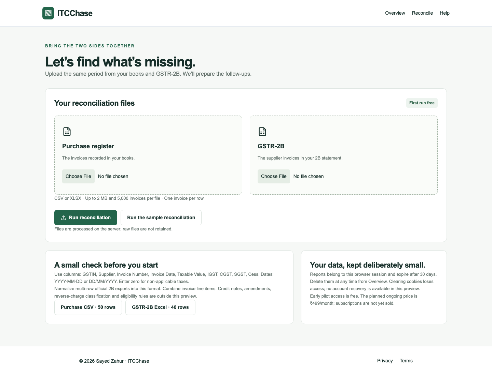
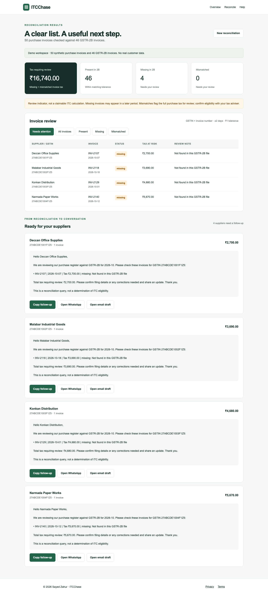
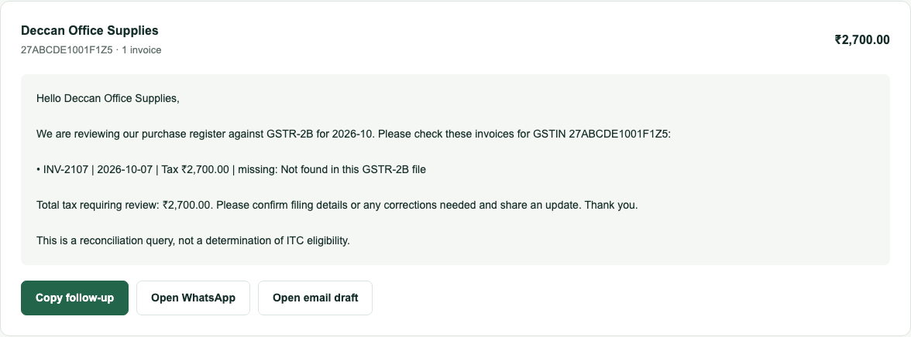
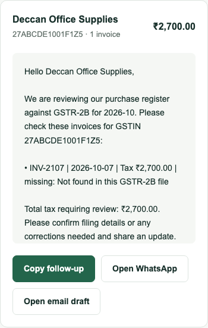
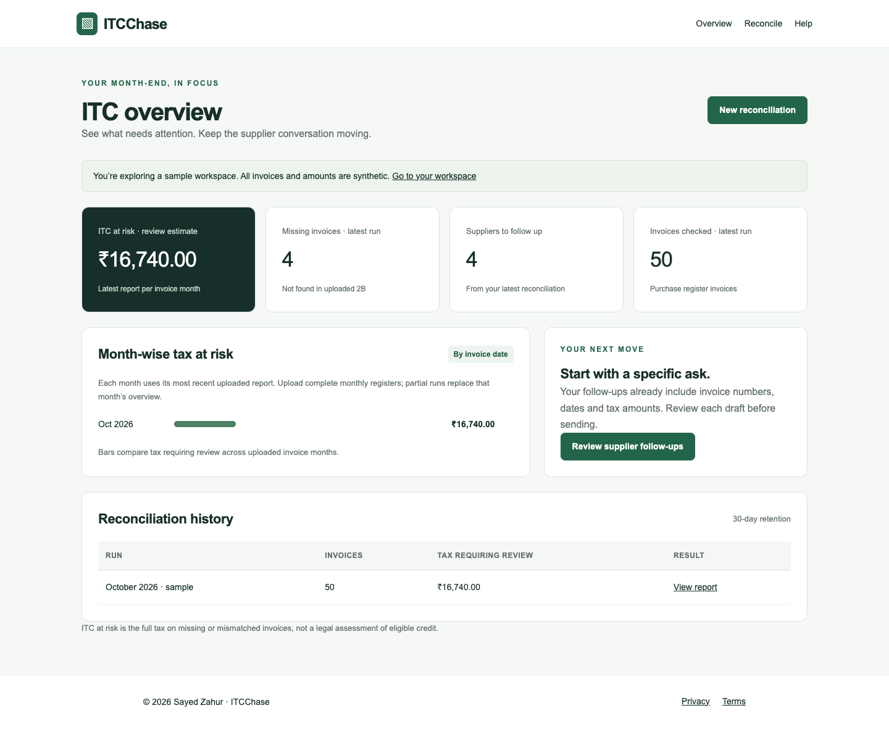
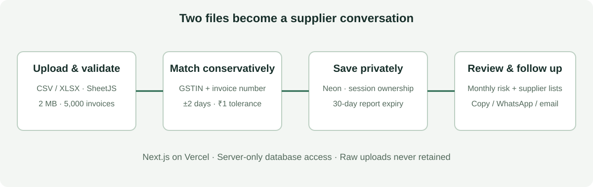
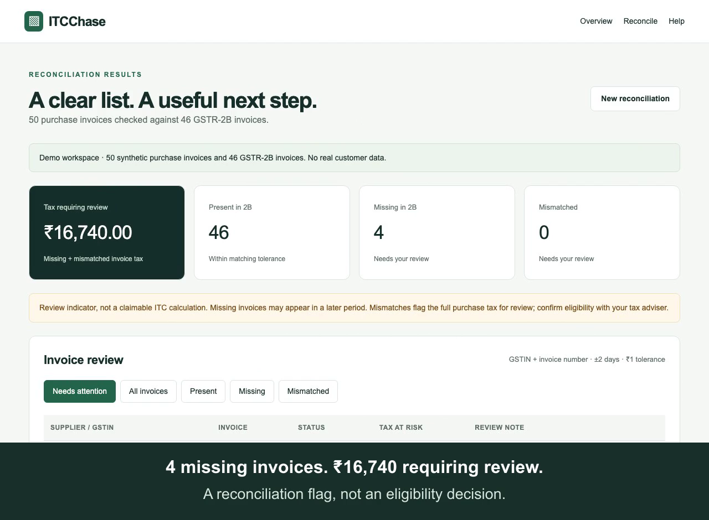

<p align="center"></p>
<p align="center">Turn purchase-register and GSTR-2B differences into supplier follow-ups.</p>
<p align="center"><a href="https://nextjs.org"></a> <a href="LICENSE"></a> <a href="package.json"></a> <a href="https://itcchase.vercel.app"></a></p>

## The problem

For the owner-bookkeeper of a small trading business, finding a difference is only half the work. The next task is gathering the invoice details and asking each supplier what happened.

**The job in plain language:** “Tell me which invoices need a conversation, and give me the details to start it.” This is our product framing, not a customer testimonial.

## How we felt it

We traced the month-end workflow: export the purchase register, download 2B, compare rows, filter suppliers, then reconstruct the same details in messages. That handoff from spreadsheet to conversation is what ITCChase makes explicit. We are validating this workflow with traders; we do not claim firsthand customer results or recovered credit.

## What we built

### Bring the two files together
Upload a CSV purchase register and a CSV/XLSX GSTR-2B table. Download the exact supported templates. Files are parsed on the server and never retained as raw uploads.



### Match conservatively
GSTIN and invoice number identify a pair. Dates may differ by two days; taxable value and each tax component may differ by ₹1. Ambiguous duplicate keys are rejected. The sample contains **50 purchase invoices, 46 statement invoices and exactly four missing invoices**.



### Know which suppliers need a conversation
Each supplier gets the relevant invoice list and tax requiring review. The sample’s ₹16,740 is synthetic, not recovered tax or customer savings. Missing and mismatched invoices flag their full purchase tax; professional review still determines eligibility.



### Copy a useful follow-up
Drafts contain invoice numbers, dates, GSTIN and tax amounts. Copy one or open WhatsApp/email, review the recipient and send it yourself. Nothing is automatically sent.



### Keep month-end in view
A month-wise dashboard uses the most recent report for each invoice month, avoiding double-counting reruns. Upload complete monthly files: a partial run replaces that month’s summary. Reports expire after 30 days and can be deleted immediately.



## How it works



1. Next.js receives two bounded, same-origin uploads under an opaque browser session.
2. SheetJS validates one invoice table, rejecting formulas, oversized archives and invalid amounts.
3. A deterministic one-to-one matcher calculates review flags in integer paise.
4. Parameterized queries store normalized reports in a dedicated Neon project using restricted credentials.
5. The UI groups differences by supplier and month; WhatsApp and email links open only on user action.

## Quickstart

Node 22.13+ and npm are required. The following four commands start the fully interactive synthetic demo without credentials:

```sh
git clone https://github.com/SayedZahur786/itcchase.git
cd itcchase
npm ci
npm run dev
```

Open [localhost:3000](http://localhost:3000), then **Explore the demo**. The repository is currently private; cloning requires access. Live uploads fail closed without a database. For server persistence, least-privilege setup and Vercel deployment, follow [Operations](docs/operations.md). Production verification uses [localhost:3107](http://localhost:3107).

## Screenshots

Real Playwright captures, not design mockups. [Desktop overview](docs/screenshots/dashboard-desktop.png) · [Mobile overview](docs/screenshots/dashboard-mobile.png) · [Empty workspace](docs/screenshots/empty-desktop.png) · [Privacy](docs/screenshots/privacy-desktop.png) · [Terms](docs/screenshots/terms-desktop.png) · [Support](docs/screenshots/contact-desktop.png) · [404](docs/screenshots/404-desktop.png).

Recreate every main route in desktop and mobile sizes with `npm run build && npm run shots`. [shots.spec.ts](tests/shots.spec.ts) starts the production server through the Playwright configuration. No real customer data appears in screenshots.

## Demo video

[](docs/demo.mp4)

[Play or download the MP4](docs/demo.mp4). The recording shows the real upload, four missing invoices, copied follow-up and saved monthly overview. It includes local text-to-speech narration and large burned-in captions. [Storyline](docs/demo-story.md) · [Recording script](scripts/record-demo.mjs) · [Rendering script](scripts/render-demo.mjs).

## Why this is interesting

- **Conservative matching over fuzzy confidence.** Punctuation remains meaningful; duplicates fail closed. This can require more manual review but avoids quietly pairing different invoices.
- **Follow-up as the final output.** Supplier-specific messages complete the workflow without sending anything automatically. This keeps the human responsible for recipient and wording.
- **Small, explicit data footprint.** Raw files are discarded; browser-owned reports have a 30-day access window. The trade-off is no cross-device login or recovery after cookies are lost.

## Verification and limits

`npm test`, `npm run typecheck`, `npm run lint`, `npm run build`, `npm run test:e2e` and `npm audit` cover logic, production compilation, browser workflows and dependencies. See [Security audit](docs/security-audit.md) and [Launch status](LAUNCH.md) for exact gate outcomes and remaining work. Automated checks are not a penetration test or legal certification.

This preview requires normalized 2B tables; nested official exports may need preparation. Credit notes, amendments, filing, GSTN integration, eligibility rules and agency accounts are out of scope. First run is free; pilot access currently remains free. **₹499/month is planned pricing, and paid checkout is not active.** There are no claimed paid firms or customer reconciliations at launch.

[Privacy](https://itcchase.vercel.app/privacy) · [Terms](https://itcchase.vercel.app/terms) · [Private support form](https://itcchase.vercel.app/contact). Operated by Sayed Zahur. Source is [all rights reserved](LICENSE); dependency licenses are unchanged.
